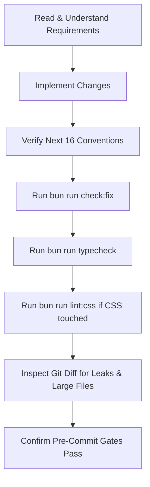

<!-- BEGIN:nextjs-agent-rules -->

# This is NOT the Next.js you know

This version has breaking changes — APIs, conventions, and file structure may all differ from your training data. Read the relevant guide in `node_modules/next/dist/docs/` (resolved from this file's directory; in monorepos the `next` package may not be visible from the repo root) before writing any code. Heed deprecation notices.

This block is written and re-added by `next dev` — verify at `node_modules/next/dist/server/lib/generate-agent-files.js`. Removing it from a diff only re-creates the uncommitted change; committing it with your work keeps the tree clean.

<!-- END:nextjs-agent-rules -->

# Harshil P — Portfolio & Headless CMS: Agent Handbook

This document is the definitive single source of truth for AI agents (Antigravity, Cursor, Claude Code, GitHub Copilot) working in this repository. All agents must adhere to the conventions, architecture, tooling, and security guardrails detailed below.

---

## 1. Architecture & Tech Stack Overview

- **Framework**: [Next.js 16.1+](https://nextjs.org) (App Router) + [React 19](https://react.dev)
- **Language**: TypeScript 5.8+ (Strict mode, full type-safety)
- **Styling**: Tailwind CSS 3.4+ integrated with a 4-flavor [Catppuccin](https://catppuccin.com) theme system (`mocha`, `latte`, `frappe`, `macchiato`) and dynamic accent switching
- **Database & Auth**: [Supabase](https://supabase.com) (PostgreSQL, Row Level Security, Storage buckets for images & PDFs)
- **CMS / Admin**: Custom in-app headless CMS located at `/admin`, protected via HMAC cookie session tokens
- **Interactive & AI Features**: 
  - Interactive Leaflet map (`LocationMapWidget`)
  - Canvas-to-ASCII art avatar rendering engine (`AsciiImage`)
  - Drag-and-drop sortable lists with [@dnd-kit](https://dndkit.com)
  - GitHub commits and repository activity synchronization
- **Tooling & Quality**: [Biome](https://biomejs.dev) 2.5 (linter & formatter), [Stylelint](https://stylelint.io), and Husky pre-commit verification pipeline (`scripts/pre-commit.mjs`)

---

## 2. Directory Layout & Critical Entrypoints

```
Portfolio/
├── AGENTS.md                  # Unified AI agent handbook & operating standards
├── CLAUDE.md                  # Imports @AGENTS.md for Claude Code compatibility
├── style-guide.md             # Design tokens reference & accessibility specs
├── components.md              # Legacy UI component specifications
├── biome.json                 # Biome linter & formatter rules (tabs, single-quotes)
├── tailwind.config.ts         # Tailwind theme extension for Catppuccin tokens & fonts
├── supabase/
│   └── schema.sql             # SQL definitions: tables, RLS policies, storage bucket
├── scripts/
│   └── pre-commit.mjs         # 4-gate pre-commit verification pipeline
└── src/
    ├── proxy.ts               # Next.js 16 edge proxy (replaces middleware.ts)
    ├── types/
    │   └── index.ts           # Global data types (Profile, Project, Experience, etc.)
    ├── app/
    │   ├── layout.tsx         # Root layout with theme hydration & metadata generator
    │   ├── page.tsx           # Primary portfolio resume single-page view
    │   ├── actions.ts         # Next.js Server Actions ('use server') for all data mutations
    │   ├── base.css           # Catppuccin theme variables, fonts, and Tailwind directives
    │   ├── components.css     # Shared component-level custom CSS rules
    │   ├── app.css            # Global application utility styles
    │   ├── admin/             # Headless CMS dashboard (/admin) & authentication
    │   │   ├── page.tsx       # Main admin view with tabs for every data entity
    │   │   ├── login/         # Passcode login route (/admin/login)
    │   │   └── _components/   # Admin tab editors (ProjectsTab, ExperienceTab, etc.)
    │   ├── projects/          # Standalone projects catalog view
    │   ├── experience/        # Standalone work & leadership experience view
    │   └── contact/           # Standalone contact & public testimonial submission
    ├── components/
    │   ├── layout/            # MinimalNav, Footer, Navigation dock
    │   ├── resume/            # Core resume widgets (Header, AffiliationRibbon, LocationMapWidget, etc.)
    │   ├── theme/             # ThemeContext (palette & accent switcher)
    │   └── ui/                # AsciiImage, FileUpload, ImageEditorModal
    └── lib/
        ├── auth.ts            # Admin authentication token generator & session checks
        ├── data/              # Supabase data access layer (projects.ts, profile.ts, etc.)
        ├── supabase/          # Supabase client (public anon) & server (service role) clients
        └── utils.ts           # General utility functions
```

---

## 3. Next.js 16 & React 19 Breaking Conventions

This repository runs on **Next.js 16** and **React 19**. Common assumptions from older Next.js versions will break the build. Agents must strictly follow these rules:

### A. Edge Proxy Pattern (`src/proxy.ts`)
- In Next.js 16+, **`src/proxy.ts` replaces `middleware.ts`**.
- The file must export a function named `proxy(request: NextRequest)`.
- **DO NOT create or re-introduce `middleware.ts`**.

### B. Asynchronous Context & Route Parameters
- Next.js 16 makes dynamic route parameters and headers asynchronous:
  ```tsx
  // Correct in Next.js 16
  const cookieStore = await cookies();
  const token = cookieStore.get('admin_token')?.value;

  // Page props with dynamic params must await params:
  export default async function Page({ params }: { params: Promise<{ slug: string }> }) {
    const { slug } = await params;
  }
  ```

### C. Server Actions Architecture (`src/app/actions.ts`)
- All database mutations must use Next.js Server Actions tagged with `'use server'`.
- Privileged operations must verify admin credentials using `await requireAdminAuth()`.
- Always purge the relevant cache tag/path with `revalidatePath(...)` after a mutation so public pages reflect changes instantly.

### D. Client-Side Only Module Isolation (`ssr: false`)
- Libraries that depend on the browser `window`, canvas, or native DOM APIs (e.g., **Leaflet Maps**) MUST be dynamically imported with `ssr: false`:
  ```tsx
  const LocationMapWidget = dynamic(
    () => import('./LocationMapWidget').then((mod) => mod.LocationMapWidget),
    { ssr: false, loading: () => <LoadingSkeleton /> }
  );
  ```

---

## 4. Development Workflow & Command Standards

This project utilizes **Bun** as the primary runtime and package manager, with **npm** as the standard fallback.

| Task | Primary Command (Bun) | Fallback Command (npm) | Notes |
| :--- | :--- | :--- | :--- |
| **Start Dev Server** | `bun run dev` | `npm run dev` | Runs Next.js 16 dev server at `localhost:3000` |
| **Type Check** | `bun run typecheck` | `npm run typecheck` | Executes `tsc --noEmit` across entire repo |
| **Lint & Format Check** | `bun run check` | `npm run check` | Runs `biome check .` |
| **Auto-Fix & Format** | `bun run check:fix` | `npm run check:fix` | Automatically formats and resolves Biome issues |
| **Format Files** | `bun run format` | `npm run format` | Runs `biome format --write .` |
| **CSS Linting** | `bun run lint:css` | `npm run lint:css` | Verifies CSS syntax via Stylelint |
| **Verify Pre-Commit Gates** | `bun run precommit` | `npm run precommit` | Runs `scripts/pre-commit.mjs` verification |
| **Production Build** | `bun run build` | `npm run build` | Builds optimized Next.js production bundle |

---

## 5. Code Style & Biome Configuration

Formatting and linting are strictly enforced by **Biome** (`biome.json`). Agents must adhere to these rules:

1. **Indentation**: Use **Tabs** (`indentStyle: "tab"`, width: 2). Do NOT replace with spaces.
2. **Line Width**: Max 100 characters (`lineWidth: 100`).
3. **Quotes**:
   - Single quotes for JavaScript / TypeScript: `'example'`
   - Double quotes for JSX attributes: `<div className="example" />`
4. **Semicolons**: Always include semicolons (`semicolons: "always"`).
5. **Type Imports**: Mandatory use of `import type`:
   ```tsx
   // Correct:
   import type { Project, Profile } from '@/types';
   import { saveProject } from '@/lib/data/projects';
   ```
6. **No Unused Code**: Unused variables and unused imports will fail checks (`noUnusedVariables: "warn"`, `noUnusedImports: "warn"`). Run `bun run check:fix` to prune them automatically.
7. **Accessibility (a11y)**: All `<button>` tags must have an explicit `type` attribute (`type="button"` or `type="submit"`). Images must have descriptive `alt` text.

---

## 6. Pre-Commit Verification Pipeline (`scripts/pre-commit.mjs`)

The repository runs an automated 4-gate verification pipeline on every commit. **Never bypass hooks using `--no-verify`.**

### Gate 1: Biome Staged Lint & Format
- Staged JS, TS, JSX, TSX, JSON, and CSS files are processed with `lint-staged` using `biome check --write`.

### Gate 2: Full TypeScript Compilation
- Executes `tsc --noEmit`. Any type errors, unresolvable imports, or invalid props will halt the pipeline.

### Gate 3: Security & Secret Leak Guard
- **Forbidden Files**: Committing `.env`, `.env.local`, `.env.production`, or `.env.development` is strictly BLOCKED.
- **Credential Patterns**: Diff lines are inspected for secret patterns:
  - Resend API keys: `/re_[a-zA-Z0-9_]{20,}/`
  - Supabase Service Role / JWTs: `/eyJhbGciOi[a-zA-Z0-9_-]{20,}/`
  - GitHub Tokens: `ghp_...` or `github_pat_...`
  - Discord Webhooks: `discord.com/api/webhooks/...`
  - Private SSH/RSA Keys: `-----BEGIN ... KEY-----`

### Gate 4: Code Hygiene & Git Sanity
- **File Size Cap**: Files larger than **2MB** are blocked. Large assets or ML weights must use external storage (Supabase Storage / CDN).
- **Merge Conflicts**: Checks for stray `<<<<<<< HEAD`, `=======`, or `>>>>>>>` markers.
- **Debuggers**: Prohibits stray `debugger;` statements.

---

## 7. Styling & Design System Standards

The application uses **Tailwind CSS** wired to a **Catppuccin** color theme. Agents should write utility classes referencing semantic Catppuccin tokens.

### Theme Palette & Tokens
- **Themes**: `mocha` (default dark), `latte` (light), `frappe`, `macchiato`.
- **Surfaces**:
  - `bg-base`: Primary page background
  - `bg-mantle`: Darker container / widget background
  - `bg-crust`: Deepest background layer
  - `bg-surface0` / `bg-surface1` / `bg-surface2`: Cards, borders, and elevated tiles
- **Text**:
  - `text-text`: Primary high-contrast text
  - `text-subtext0` / `text-subtext1`: Muted secondary text
  - `text-overlay0` / `text-overlay1`: Faint metadata or disabled text
- **Accents**:
  - `accent` / `text-accent` / `bg-accent`: Dynamic accent token (user selectable: `peach`, `rosewater`, `flamingo`, `pink`, `mauve`, `red`, `maroon`, `yellow`, `green`, `teal`, `sky`, `sapphire`, `blue`, `lavender`)
  - `border-surface0/80` or `border-surface1`: Subtle borders for cards and widgets
- **Typography**:
  - `font-mono`: JetBrains Mono (default font for portfolio headers, labels, metrics)
  - `font-serif`: Instrument Serif (editorial accents)
  - `font-grotesk`: Space Grotesk (sans-serif headers)

### Legacy Design Tokens & Documentation
For specifications regarding raw CSS variables (`--wall`, `--wall-dark`, `--ink`, `--ink-muted`, `--rule`, `--accent`) and legacy component specifications (`.admin-btn`, `.admin-input`, `.card`), consult:
- `style-guide.md`
- `components.md`

All legacy variables are aliased to Catppuccin tokens inside `src/app/base.css` to maintain backward compatibility.

---

## 8. Supabase Data Architecture & CMS Workflows

### Client vs. Server Separation
- **Public Client (`src/lib/supabase/client.ts`)**:
  - Uses `NEXT_PUBLIC_SUPABASE_URL` and `NEXT_PUBLIC_SUPABASE_PUBLISHABLE_KEY` (or anon key).
  - Used for public reads (`getProjects()`, `getProfile()`, `getExperience()`).
- **Admin Server Client (`src/lib/supabase/server.ts`)**:
  - Uses `SUPABASE_SERVICE_ROLE_KEY` with `{ persistSession: false }`.
  - Used strictly in server actions and server functions for mutations (`insert`, `update`, `delete`).
  - **CRITICAL**: NEVER import or leak `supabaseAdmin` into client components (`'use client'`).

### Data Entities & Schema (`supabase/schema.sql`)
1. `profile`: Single record (`id: 'main'`) with name, summary, contact, social links, ASCII art config.
2. `projects`: Portfolio projects with title, slug, description, tags, GitHub link, live link, featured flag, and display order.
3. `experience`: Career history, bullets, tech stack tags, certificates, recommendation links, and project associations.
4. `skills`: Categorized skill lists with ordering.
5. `achievements`: Honors, awards, and milestones.
6. `education`: Academic credentials and institutions.
7. `certifications`: Credentials with issuer, date, verification link, and Credly ID.
8. `testimonials`: Visitor recommendations with moderation status (`approved: boolean`).
9. `site_settings`: Global feature toggles (e.g., `show_testimonials`).
10. `footer_links`: Configurable footer links organized by category.
11. `contact_messages`: Inbound messages from portfolio visitors.

### Storage Bucket
- **`portfolio_media`**: Public bucket for profile photos, project thumbnails, and resume PDFs.

---

## 9. Interactive Widgets & Visual Engines

1. **Interactive Kerala Leaflet Map (`src/components/resume/LocationMapWidget.tsx`)**:
   - Leaflet map centered on Kerala with CartoDB Dark Matter tiles and a live IST clock.
   - Requires client-only execution (`ssr: false`).
2. **Ascii Art Generator (`src/components/ui/AsciiImage.tsx`)**:
   - Renders photos as stylized ASCII text grids with custom glyph density maps and zoom controls.
   - Respects user preference between photo and ASCII mode in `Profile.social.avatar_mode`.
3. **Recent Engineering Activity (`src/components/resume/RecentCommits.tsx` & `GitHubContributionGraph.tsx`)**:
   - Fetches public commit history and contribution graphs for the profile GitHub handle (`erzer12`).
   - Handles rate limits gracefully by returning fallback mock/cached data.

---

## 10. Agent Step-by-Step Change Protocol

Before marking any task complete, all agents MUST follow this checklist:



1. **Check Existing Types**: Verify `src/types/index.ts` before creating new data interfaces.
2. **Follow Catppuccin Styling**: Use Tailwind classes with semantic tokens (`bg-base`, `text-text`, `bg-mantle`, `border-surface0`).
3. **Next.js 16 Conformity**:
   - Never create `middleware.ts` — use `src/proxy.ts`.
   - Await `cookies()` and dynamic `params`.
   - Guard admin server actions with `requireAdminAuth()`.
4. **Format & Clean**: Run `bun run check:fix` to organize imports and format with tabs.
5. **Type Safety**: Run `bun run typecheck` (`tsc --noEmit`). Ensure zero compiler diagnostics.
6. **Security & Size**: Ensure no secret tokens (`re_...`, `eyJ...`) or files > 2MB are introduced.
7. **Clean Commits**: Ensure the auto-generated Next.js header in `AGENTS.md` remains intact.
